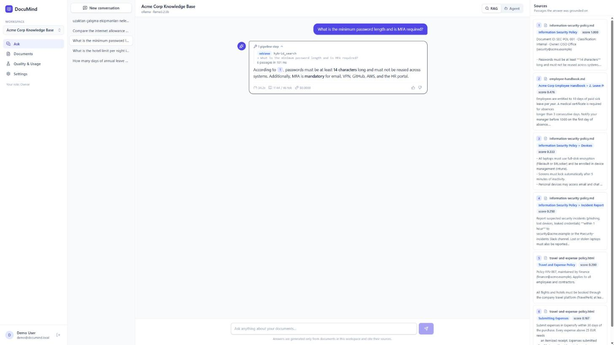
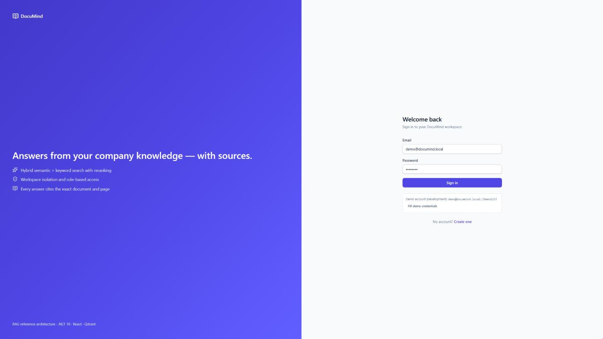
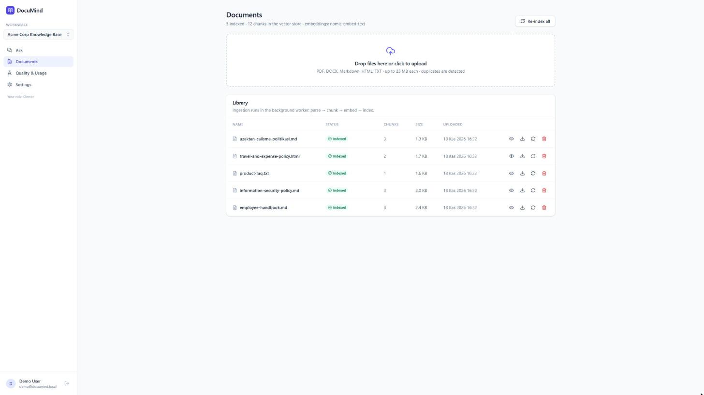
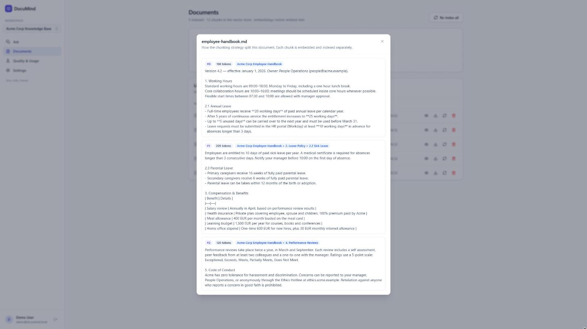
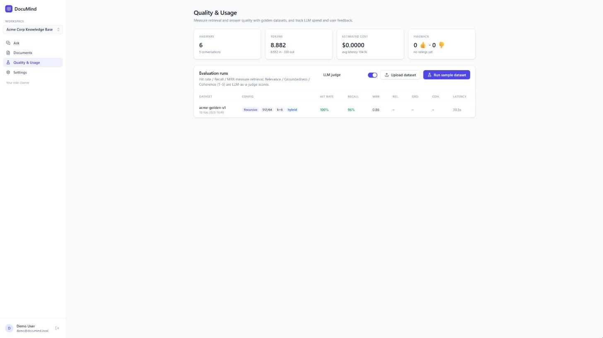
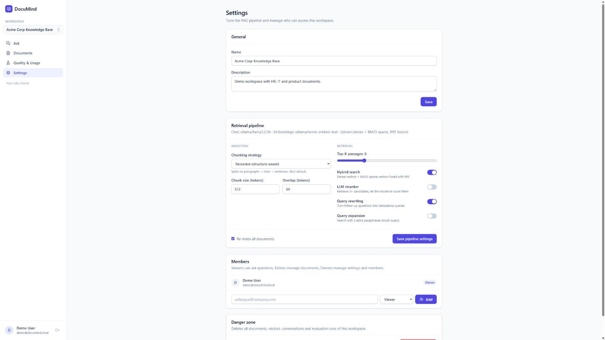
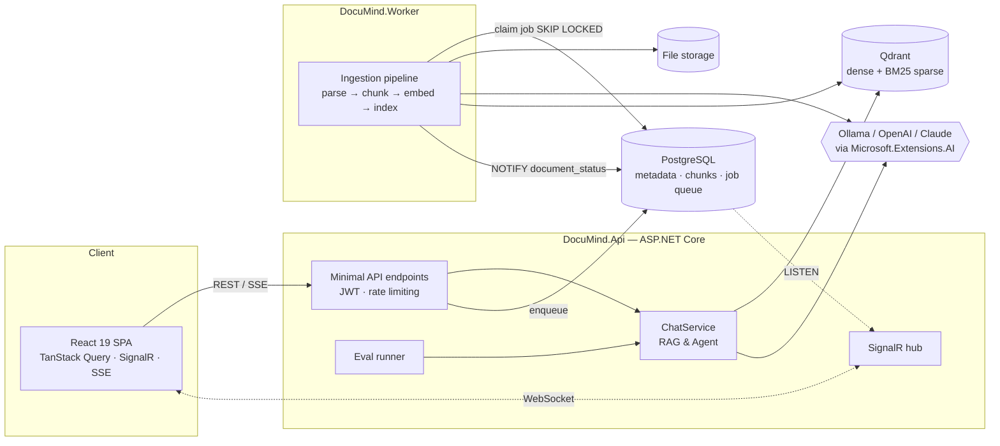
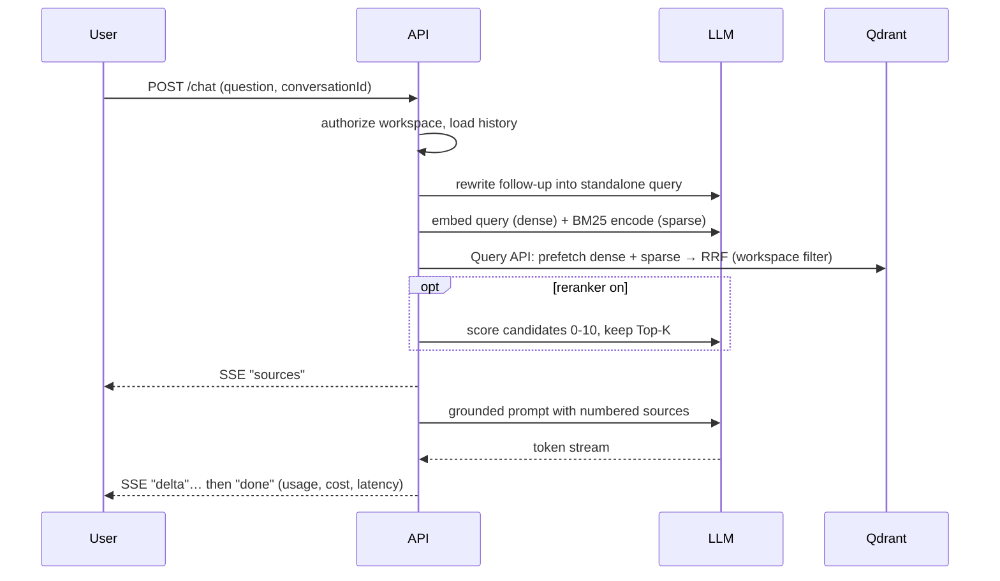

# DocuMind — Enterprise Document Assistant (RAG)

> Ask questions about your company's documents and get answers **grounded in the sources, with citations down to the page**.
> A production-style Retrieval-Augmented Generation reference app built with **.NET 10, React 19, Qdrant, PostgreSQL and Ollama / OpenAI / Claude**.

[](.github/workflows/ci.yml)




## The problem

Every company has its knowledge scattered across PDFs, Word files, wikis and HTML pages — HR policies, security rules,
contracts, product FAQs. Employees waste hours searching, and generic chatbots **hallucinate** or **leak data** across teams.

DocuMind solves the three things an enterprise knowledge assistant must get right:

| Requirement | How DocuMind handles it |
|---|---|
| **Trustworthy answers** | Grounded prompting, inline `[n]` citations, a source panel with file / page / section, "not covered" when the documents don't say |
| **Good retrieval** | Configurable chunking (fixed, recursive, semantic), hybrid dense + BM25 search fused with RRF, query rewriting, multi-query expansion, LLM reranking |
| **Data isolation** | Multi-tenant workspaces with Owner / Editor / Viewer roles; tenant filter enforced on every vector query and every SQL query |
| **Measurable quality** | Golden-dataset evaluation (Hit rate, Recall, MRR + LLM-as-a-judge Relevance / Groundedness / Coherence), token & cost tracking, user feedback, OpenTelemetry |

## Features

- 📄 **Ingestion pipeline** — PDF (page-aware), DOCX (headings & tables), Markdown (heading hierarchy), HTML (boilerplate stripped), TXT.
  Background worker, Postgres job queue (`FOR UPDATE SKIP LOCKED`), retries with exponential backoff + dead-lettering, duplicate detection (SHA-256),
  **live progress in the UI** (Postgres `NOTIFY` → SignalR).
- ✂️ **Three chunking strategies** — fixed token windows, recursive/structure-aware, and **semantic chunking** (splits where sentence-embedding distance spikes). Contextual headers (`file > section`) are embedded with every chunk.
- 🔎 **Hybrid retrieval** — Qdrant named vectors: dense (cosine) + sparse BM25 (server-side IDF), fused with **Reciprocal Rank Fusion** in a single Query API call.
- 🧠 **Query understanding** — conversational query rewriting, optional multi-query expansion, optional LLM reranker.
- 🤖 **Agent mode** — tool-calling agent (`search_documents`, `list_documents`, `get_document_section`) with the tool trace shown in the UI. Tools are bound to the workspace, so the model cannot escape its tenant.
- ⚡ **Streaming** answers over Server-Sent Events with citations, pipeline steps, latency, token usage and estimated cost.
- 🔌 **Provider-agnostic** via `Microsoft.Extensions.AI`: Ollama (default, free & local), OpenAI (or any OpenAI-compatible endpoint), Anthropic Claude.
- 📊 **Evaluation & observability** — evaluation runs from the UI or CLI (CI quality gate), usage dashboard, 👍/👎 feedback, OpenTelemetry traces & metrics (GenAI semantic conventions) in the Aspire dashboard.
- 🔐 **Security** — JWT access tokens + rotating refresh tokens (hashed at rest, reuse detection), lockout, rate limiting, RFC 9457 problem details, path-traversal-safe storage.

## Screenshots

| | |
|---|---|
|  |  |
| **Sign in** — JWT auth, demo account in development | **Documents** — upload, live ingestion status, re-index |
|  |  |
| **Chunk viewer** — how a document was split, with token counts and section paths | **Quality & Usage** — evaluation runs (hit rate, recall, MRR) and token / cost tracking |
|  |  |
| **Settings** — chunking strategy, Top-K, hybrid search, reranker, members and roles | **Ask** — streamed answer, pipeline steps, citations and sources panel |

## Architecture



**RAG request flow**



### Solution layout (Clean Architecture)

```
src/
  DocuMind.Domain          Entities & invariants (Workspace, Document, Conversation, IngestionJob, EvalRun) — no dependencies
  DocuMind.Application     Use cases: chunkers, retrieval pipeline, chat, evaluation; ports (IVectorStore, IEmbeddingService, …)
  DocuMind.Infrastructure  EF Core/Postgres, Qdrant, document parsers, AI providers, Identity/JWT, job queue, storage
  DocuMind.Api             Minimal APIs, SSE streaming, SignalR, auth, rate limiting, background eval runner
  DocuMind.Worker          Horizontally scalable ingestion consumer
  DocuMind.Eval            CLI: run a golden dataset against the API, markdown report, CI quality gate
  DocuMind.AppHost         .NET Aspire orchestration (Postgres, Qdrant, Ollama + models, API, Worker, React)
  DocuMind.ServiceDefaults OpenTelemetry, health checks, resilience
tests/
  DocuMind.UnitTests          chunking, BM25, RRF, context packing, reranker fallback, parsers, domain rules
  DocuMind.IntegrationTests   real Postgres + Qdrant via Testcontainers, fake LLM: ingest → chat, tenant isolation, auth
  DocuMind.ArchitectureTests  layer dependency rules (NetArchTest)
web/                          React 19 + Vite + TypeScript + Tailwind v4
samples/docs                  demo knowledge base (EN + TR)
eval/datasets                 golden dataset matching the samples
```

## Getting started

### Prerequisites
- [.NET 10 SDK](https://dotnet.microsoft.com/download), [Node.js 22+](https://nodejs.org), [Docker Desktop](https://www.docker.com/products/docker-desktop/)
- ~4 GB free disk for the local models (`llama3.2:3b` + `nomic-embed-text`)

### Option A — one command with .NET Aspire (recommended)

```bash
cd web && npm install && cd ..
dotnet run --project src/DocuMind.AppHost
```

The Aspire dashboard opens automatically. It starts PostgreSQL, Qdrant and Ollama in containers, **pulls the models**,
then the API, the worker and the React app. Open the `web` endpoint from the dashboard and sign in with the demo account:

```
demo@documind.local / Demo123!
```

The demo workspace is pre-loaded with the files in `samples/docs`, so you can ask questions right away.
Traces of every request (HTTP → retrieval → LLM calls with token counts) are visible in the dashboard.

> **Faster local inference:** if you have Ollama installed natively (uses your GPU), set `"Ollama": { "Mode": "local" }` in
> `src/DocuMind.AppHost/appsettings.json`. For the Ollama container with an NVIDIA GPU set `"Gpu": true`
> (requires a recent NVIDIA driver).

### Option B — Docker Compose + dotnet run

```bash
docker compose up -d          # postgres, qdrant, ollama (+ model pull), aspire-dashboard
# NVIDIA GPU: docker compose -f docker-compose.yml -f docker-compose.gpu.yml up -d

dotnet run --project src/DocuMind.Api        # http://localhost:5080  (API reference: /scalar)
dotnet run --project src/DocuMind.Worker
cd web && npm install && npm run dev          # http://localhost:5173
```

Set `OTEL_EXPORTER_OTLP_ENDPOINT=http://localhost:4317` on the API/Worker to see telemetry at http://localhost:18888.
Qdrant's own UI is at http://localhost:6333/dashboard.

## Choosing the AI provider

All AI access goes through `Microsoft.Extensions.AI`, so switching is configuration only (AppHost `appsettings.json`
for Aspire, or the API/Worker `appsettings.json`). Keep keys in **user-secrets**, never in the repo:

| Setup | Configuration |
|---|---|
| Local, free (default) | `AI:ChatProvider=ollama`, `AI:ChatModel=llama3.2:3b` (or `llama3.1:8b` / `qwen2.5:7b` for better quality) |
| OpenAI | `AI:ChatProvider=openai`, `AI:EmbeddingProvider=openai`, `AI:ChatModel=gpt-4.1-mini`, `AI:EmbeddingModel=text-embedding-3-small`, `AI:DocumentPrefix=`, `AI:QueryPrefix=`, `AI:OpenAI:ApiKey` |
| Claude + local embeddings | `AI:ChatProvider=anthropic`, `AI:ChatModel=claude-sonnet-5-5`, `AI:Anthropic:ApiKey` (Anthropic has no embedding API — keep Ollama or OpenAI embeddings) |

```bash
dotnet user-secrets --project src/DocuMind.AppHost set "AI:Anthropic:ApiKey" "sk-ant-..."
```

Vector collections are named per embedding model and dimension (`documind_<model>_<dims>`), so changing the embedding
model never mixes incompatible vectors — just press **Re-index all** on the Documents page.

## Evaluation

RAG quality has to be measured, not guessed. DocuMind runs a golden dataset through the **exact production pipeline**:

- **Retrieval**: Hit rate (any expected document in the results), Recall (share of expected documents found), MRR
- **Generation** (LLM-as-a-judge, `Microsoft.Extensions.AI.Evaluation.Quality`): Relevance, Groundedness, Coherence on a 1–5 scale

Every run stores a snapshot of the workspace settings, so you can compare e.g. *Recursive vs Semantic chunking* or
*reranker on vs off* side by side on the **Quality & Usage** page.

```bash
# against a running API; exits non-zero below the threshold → usable as a CI quality gate
dotnet run --project src/DocuMind.Eval -- --dataset eval/datasets/sample-golden.json --min-hit-rate 0.8 --out eval-report.md
#   --seed samples/docs   upload documents first      --no-judge   skip the (slow) LLM judge
```

Sample result on the bundled dataset (12 questions in English and Turkish, `llama3.2:3b` + `nomic-embed-text` on CPU,
recursive chunking 512/64, hybrid search, Top-6, no reranker):

| Hit rate | Recall | MRR | Avg latency (CPU) |
|---|---|---|---|
| 100 % | 96 % | 0.86 | ~39 s |

Dataset format:

```json
{ "name": "acme-golden-v1",
  "items": [ { "question": "What is the minimum password length?",
               "expectedDocuments": ["information-security-policy.md"],
               "referenceAnswer": "14 characters." } ] }
```

## Testing

```bash
dotnet test                       # unit + architecture + integration (integration tests need Docker)
cd web && npm test && npm run lint
```

Integration tests boot the real API with `WebApplicationFactory` against **real PostgreSQL and Qdrant containers**
(Testcontainers). Only the LLM and embedding model are swapped for deterministic fakes, which keeps the tests fast,
free and reproducible while still exercising migrations, the job queue, hybrid search, SSE streaming and tenant isolation.

## Design decisions

| Decision | Why |
|---|---|
| Postgres as the job queue (`SKIP LOCKED` + lease + `LISTEN/NOTIFY`) | Transactional with the metadata, no extra broker to run, scales to many workers |
| Client-side BM25 sparse vectors + Qdrant IDF modifier | True hybrid search (exact terms like `SEC-POL-001`, names, numbers) without a second search engine |
| RRF instead of score blending | Dense and sparse scores are not comparable; rank-based fusion is robust and parameter-free |
| Chunk text duplicated in Postgres | Citations, chunk viewer and "read surrounding section" tool work without touching the vector store |
| 404 for other tenants' resources | Workspace ids cannot be probed |
| UUIDv7 ids | Time-ordered → index-friendly inserts, generated client-side |
| No MediatR / MassTransit / FluentAssertions | They moved to commercial licenses; the app uses plain services, a Postgres queue and Shouldly |

## Roadmap ideas

OCR for scanned PDFs · cross-encoder reranker (e.g. `bge-reranker`) · document-level ACLs · S3/Azure Blob storage ·
semantic caching of answers · Kubernetes manifests via `aspire publish`.

## License

MIT
